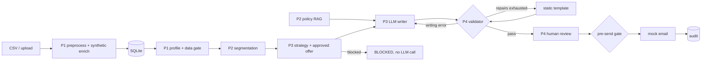

# Customer Loyalty and Engagement Assistant

HCLTech Future Ready AI Engineer Hackathon prototype for telecom customer engagement.

> **The core principle:** Python decides eligibility and actions. RAG retrieves policy. The LLM only writes the wording. Deterministic validators enforce safety. A human approves every delivery.
> The system never sends real email, never sends in bulk and never makes financial decisions.

---

## 1. Project overview

The assistant takes a customer from the churn dataset through these stages:

1. Builds a verified profile.
2. Assigns transparent segments, each with reason codes.
3. Explains decisions from policy documents (RAG).
4. Picks a policy-approved strategy and offer.
5. Has an LLM draft a personalised email.
6. Validates every fact, offer, consent rule and phrase.
7. Routes the draft to a human reviewer.
8. Performs a mock delivery.
9. Records everything in an audit trail.

It runs fully offline: with no API key it uses approved static templates. Add an `ANTHROPIC_API_KEY` to switch on Claude.

| | |
|---|---|
| UI | Streamlit app with 9 pages: dashboard, explorer, classification, policy chat, offers/strategy, generator, review, audit, evaluation |
| API | FastAPI app with 19 endpoints; docs at `/docs` |
| Tests | 120 pytest tests (unit, integration and UI smoke tests) |
| Evaluation | `reports/evaluation_report.md`, regenerated with one command |

## 2. Problem statement

Companies often send the same promotional email to every customer. A loyal customer then gets a generic promotion, a lapsing customer gets no reason to come back, and an overdue customer gets a discount instead of a reminder. This assistant gives each customer the right message:

| Customer behaviour | Message |
|---|---|
| Pays on time and is active (CONSISTENT) | Appreciation, with an optional thank-you bonus |
| Long tenure (LOYAL) | Thanks plus an approved loyalty reward |
| Usage dropped by more than 40% (DECLINING) | Friendly re-engagement offer |
| No activity for 90+ days (DORMANT) | Reactivation / win-back offer |
| Overdue bill (OVERDUE) | Courteous, then firm, then formal reminder. Never a promotion. |

## 3. Architecture



The full diagram is in [`architecture.mmd`](architecture.mmd).

## 4. HLD (high-level design)

| Layer | Components | Decides? |
|---|---|---|
| Data (P1) | Chunked CSV loader, cleaning, synthetic enrichment, profile builder, SQLite repository | No (only checks data quality) |
| Decision (P2/P3) | Segmentation engine, offer eligibility, strategy selector, suppression rules | **Yes**, deterministically from YAML policy files |
| Knowledge (P2) | 9 synthetic policy documents, section chunking, embeddings, vector store, retriever, policy Q&A | No; it only explains |
| Generation (P3) | Prompt manager, LLM client (Claude, OpenAI-compatible, or none), email generator, repair/fallback loop | No; it only writes |
| Control (P4) | Validator (16+ checks), human review, pre-send gate, mock email, audit, metrics, evaluation | Blocks; humans approve |

The Streamlit UI and the FastAPI API share one dependency container (`backend/services/container.py`), so both run exactly the same logic.

## 5. LLD (low-level design)

- **Contracts:** shared Pydantic models in `backend/schemas/models.py`: `CustomerProfile → SegmentResult → Strategy → EmailContent → ValidationReport → Draft`.
- **Draft states:** `PENDING_REVIEW`, `NEEDS_FIX` (an edit failed validation), `BLOCKED`, `APPROVED`, `REJECTED`, `MOCK_SENT`, `CANCELLED`. No path leads to `MOCK_SENT` without passing through `APPROVED` and the pre-send gate.
- **Database tables:** `customers`, `offers`, `policies`, `customer_segments`, `strategies`, `drafts`, `validation_reports`, `review_actions`, `contact_history`, `mock_deliveries`, `generation_attempts`, `audit_logs`.
- **Failure categories:** each validator finding carries `DATA | POLICY | WRITING | FORMAT`. The generation loop uses the category to choose between block, repair and retry (section 16).
- **Idempotency:** creating a draft returns the existing open draft unless `supersede=true`. Each draft can be delivered at most once (`UNIQUE(draft_id)` in `mock_deliveries`).

Detailed inputs and outputs are in [API_CONTRACTS.md](API_CONTRACTS.md) and [INTEGRATION_GUIDE.md](INTEGRATION_GUIDE.md).

## 6. Technology stack

| Area | Technology | Fallback when missing |
|---|---|---|
| Language | Python 3.11+ (tested on 3.13) | |
| API | FastAPI, Pydantic v2, Uvicorn | |
| UI | Streamlit 1.40+, Plotly | `st.bar_chart` |
| Data | Pandas (chunked), SQLite (stdlib `sqlite3`) | |
| RAG | ChromaDB, Sentence Transformers `all-MiniLM-L6-v2` | Local NumPy store + scikit-learn TF-IDF |
| LLM | Anthropic Claude (SDK, or HTTPS through the standard library); any OpenAI-compatible endpoint | Approved static templates |
| Validation | Python, regex, Pydantic; optional Presidio; optional LLM tone judge | Regex only |
| Tests | Pytest, FastAPI TestClient | Built-in fakes for Streamlit and FastAPI |

The build spec suggested SQLAlchemy. Plain `sqlite3` is used instead to keep the prototype dependency-free. All writes run inside transactions.

## 7. Dataset setup

**Dataset:** Kaggle *Customer Churn Prediction Dataset 1M* (`isandeep06/customer-churn-prediction-dataset-1m`, file `customer_churn_1m.csv`, 32 columns, about 1,000,000 rows).

```bash
python scripts/download_dataset.py        # needs kaggle package + credentials, else prints manual steps
# or download manually to data/raw/customer_churn_1m.csv
# or upload the CSV on the Streamlit "Customer Explorer" page / POST /customers/upload
python scripts/validate_data.py --csv data/raw/customer_churn_1m.csv   # header check + reports/dataset_profile.md
```

The loader never assumes the layout. `inspect_csv` reads the real header, and `check_mapping` fails loudly if `customer_id` is missing. Column mapping lives in [`config/data_mapping.yaml`](config/data_mapping.yaml).

**Without Kaggle access**, `scripts/make_sample_dataset.py` (or the dashboard button) generates a **local stand-in** with the same 32 columns. Its rows are random, are stored with `data_source='sample'` and are never presented as Kaggle data.

## 8. Data preprocessing

The pipeline runs in 100k-row chunks, so 1M rows never sit in memory at once. Each chunk goes through these steps:

1. Map source columns to internal names.
2. Drop protected columns and proxies: `gender, age, senior_citizen, marital_status, dependents, education, annual_income, credit_score, signup_date`.
3. Drop rows with a missing ID, and drop duplicate IDs within the chunk and across chunks.
4. Coerce numeric fields. Invalid or negative values become nulls and are counted.
5. Impute `total_charges` (the one documented imputation: monthly charges × tenure).
6. Normalise contract values.

Missing evidence stays missing and is flagged by the profile builder; it is never guessed. All cleaning statistics are returned and shown in the UI. Staged scripts: `preprocess_data.py → generate_synthetic_data.py → load_database.py`, or run everything in one go with `load_database.py --csv`.

**Measured throughput** (100k-row sample on the build machine): ingestion with cleaning and enrichment took 4.6 s, batch classification took 16 s, and a filtered, paginated customer query took about 80 ms. For the full 1M rows, expect roughly 1 minute to load and 3 minutes to classify. `setup_all.py` loads 50k rows by default; pass `--limit 0` for all of them.

## 9. Synthetic enrichment

The churn dataset has no names, billing dates, consent or contact history, so these fields are generated in `modules/data_engineering/synthetic_generator.py`.

- **Deterministic:** every value comes from `hash(seed, customer_id, field)`. The same seed always gives the same data, regardless of chunk size. Set `SYNTHETIC_SEED` to change it.
- **Labelled:** provenance (`original` / `derived` / `synthetic`) is listed in `data_mapping.yaml` and shown on every profile in the Customer Explorer.
- **Consistent:**
  - `PAID` always means `amount_due = 0` with a future due date.
  - `UNPAID` amount = monthly charges × months outstanding, with a due date in the past.
  - Unpaid probability rises with the real `late_payments` column.
  - `last_active_date` is derived from the real `days_since_last_interaction`.
  - Declining usage is more likely for churned customers.
- **Fair:** protected attributes are never inputs.

13 hand-labelled **demo customers** (`demo_customers.py`, `data_source='demo'`) cover every scenario.

## 10. RAG architecture

- **Documents:** 9 synthetic policies in `knowledge_base/policies/` (loyalty, segmentation, consent, offer eligibility, payment reminders, frequency, tone, privacy, dispute/escalation). Each is labelled *synthetic demonstration policy*.
- **Chunking:** one chunk per `##` section, with metadata `doc_id, section, version, segments`. Lines that look like prompt injection ("ignore previous instructions…") are stripped and the chunk is flagged.
- **Embeddings and store:** Sentence Transformers + ChromaDB when installed; otherwise TF-IDF (1–2 grams) + a local NumPy store. The index rebuilds automatically when a document's SHA-256 changes. Versions are recorded in the `policies` table.
- **Retrieval:** cosine top-k with metadata filters (segment, current version) and a minimum-score threshold.
- **Customer policy Q&A** (`policy_qa.py`):
  1. Gathers the selected customer's verified decision evidence (profile without name or email, segment, strategy).
  2. Retrieves policy excerpts. The policy sections cited by the decision itself are pinned first.
  3. Answers with sources.
  4. Returns exactly `Insufficient policy evidence to answer this question.` when the excerpts do not cover the question.

  With Claude configured, the answer is written by the LLM under a strict prompt. Offline, it is composed deterministically from the same evidence. RAG never overrides the rules, and only the selected customer's data is ever used.
- **Generation guidance:** tone and required-content sections for the chosen strategy are passed to the writer inside `<policy_guidance>` tags. The prompt marks them as untrusted.

## 11. Segmentation logic

Rules live in [`policies/segmentation.yaml`](policies/segmentation.yaml). Priority order: OVERDUE > DORMANT > DECLINING > LOYAL > CONSISTENT.

| Segment | Rule | Reason codes |
|---|---|---|
| OVERDUE | `days_overdue > 0` | OVERDUE_GT_0D |
| DORMANT | `days_since_active >= 90` | INACTIVE_GE_90D |
| DECLINING | `usage_prev_3m > 0` and `usage_last_3m < 0.6 × usage_prev_3m` | HAS_PRIOR_USAGE, USAGE_DROP_GT_40PCT |
| LOYAL | `tenure_months >= 36` | TENURE_GE_36M |
| CONSISTENT | `on_time_payment_ratio >= 0.95` and `days_since_active < 30` | ON_TIME_GE_95PCT, ACTIVE_LT_30D |

- All matching segments and per-rule evidence are kept.
- Confidence drops when a value sits close to a threshold. Below 0.6, the customer goes to manual review.
- Blocking data issues, missing required fields or no matching rule also send the customer to `MANUAL_REVIEW`, never to a guessed segment.
- The dataset's churn label is displayed but never drives treatment.

## 12. Strategy selection

| Segment | Objective | Tone | Offer | Template |
|---|---|---|---|---|
| CONSISTENT | APPRECIATION | WARM | Optional | TPL_THANKS |
| LOYAL | REWARD | WARM | Required (falls back to APPRECIATION if none) | TPL_LOYALTY |
| DECLINING | REENGAGE | FRIENDLY | Preferred | TPL_REENGAGE |
| DORMANT | REACTIVATE | FRIENDLY | Preferred | TPL_REACTIVATE |
| OVERDUE | REMIND | COURTEOUS / FIRM / FORMAL | **Never** | TPL_REMIND_S1/S2/S3 |

**Reminder stages** (boundaries inclusive, set in `payment_reminders.yaml`): days 1–15 are stage 1, days 16–30 stage 2, and day 31+ stage 3.

**Suppression rules:**

| Rule | Effect |
|---|---|
| `NO_CONSENT` | Blocks marketing. Reminders are service messages and are still allowed. |
| `RECENT_CONTACT` | 7-day cooldown for marketing, 5-day cooldown for reminders |
| `DUPLICATE_OUTREACH` | Same template within 30 days |
| Overdue | Never receives an offer |
| Data / manual review | Escalates the case |

Only fields on the privacy allow-list are passed to the writer as verified facts.

## 13. Offer catalog

[`policies/offers.yaml`](policies/offers.yaml) holds approved synthetic offers: LOYALTY_001, REENGAGE_001, WINBACK_001 and THANKS_001. It also contains two test offers:

- **LOYALTY_2025** has expired. It demonstrates case F.
- **SMS_ONLY_001** is SMS-only. It demonstrates the channel rule.

An offer is eligible only when all of these hold:
- status is ACTIVE;
- the date is between start and expiry;
- the customer's segment is eligible;
- minimum tenure is met;
- the channel is EMAIL;
- marketing consent is present;
- the customer is not overdue.

Every offer gets an explained accept or reject decision. Offers are never generated dynamically.

## 14. LLM prompts

Versioned prompt files live in `prompts/`, with a header such as `# version: email_generation@v1`:

| File | Purpose |
|---|---|
| `email_generation.txt` | Writes the email. Uses only the verified facts, which are written as **placeholders** such as `{amount_due}` and filled in by code. No invented numbers, no promotions in reminders, no internal labels. Policy guidance is marked untrusted. Output is JSON `{subject, body, cta}`. |
| `email_repair.txt` | Lists the exact failed checks and asks the model to fix only those. |
| `policy_qa.txt` | Answers a question from decision evidence plus excerpts, citing sources and flagging insufficient evidence. |
| `tone_judge.txt` | Rubric scores 1–5 for respectfulness, clarity, tone match and pressure tactics. |

Generation runs at temperature 0.2; the judge and Q&A run at 0. Every draft and audit record stores the prompt version and model name.

## 15. Validation architecture

The validator is in `modules/validation/` and is fully deterministic. A draft passes only when no BLOCK-severity check fails.

| # | Check | Module | Category |
|---|---|---|---|
| 1 | JSON schema and length (Pydantic) | validator.py | FORMAT |
| 2 | Amount verification (every currency amount must equal a verified amount) | fact_validator.py | WRITING |
| 3 | Percentage verification (only the attached offer's percentage) | fact_validator.py | WRITING |
| 4 | Date verification (only the due date and offer expiry) | fact_validator.py | WRITING |
| 5 | Unsupported numeric claims (every number must appear in a verified fact) | fact_validator.py | WRITING |
| 6 | Unresolved or unknown placeholders | fact_validator.py | WRITING |
| 7 | Offer existence in the catalog | offer_validator.py | POLICY |
| 8 | Offer eligibility (re-checked) | offer_validator.py | POLICY |
| 9 | Offer expiry | offer_validator.py | POLICY |
| 10 | Offer value, terms and expiry stated exactly; no other offers mentioned | offer_validator.py | WRITING |
| 11 | No promotion in reminders / no unapproved promotion | offer_validator.py | WRITING |
| 12 | Payment status consistency + data quality | payment_validator.py | DATA |
| 13 | Overdue stage matches days overdue | payment_validator.py | POLICY |
| 14 | Marketing consent | consent_validator.py | POLICY |
| 15 | Communication frequency (cooldown) | consent_validator.py | POLICY |
| 16 | Duplicate outreach (template or content hash) | consent_validator.py | POLICY |
| 17 | Prohibited phrases, internal-label disclosure | tone_validator.py | WRITING |
| 18 | PII leakage: Luhn card numbers, ID patterns, unapproved emails/phones/links, customer ID; optional Presidio | pii_validator.py | WRITING |
| 19 | Required content (amount, due date, support phone, dispute link for reminders) | validator.py | WRITING |
| 20 | Tone heuristics (markers, exclamations, ALL CAPS) | tone_validator.py | WARN only |
| 21 | LLM tone judge (smaller model, temperature 0) | tone_validator.py | **Advisory WARN only.** It can never approve or send. |

The validator reports which checks failed, `retry_recommended`, and the failure categories. It never depends on an LLM to verify amounts, dates, eligibility or offers.

## 16. Regeneration logic and resource consumption

| Failure | Example | Action | Uses the LLM? |
|---|---|---|---|
| DATA | Contradictory or missing billing, missing evidence | BLOCK and escalate to a human | **No** |
| POLICY | No consent, expired offer, ineligible, recent contact | BLOCK, or recompute the strategy (e.g. expired offer → valid offer) | **No** |
| WRITING | Wrong amount, banned phrase, missing dispute link, invented discount | Targeted repair prompt listing the failed checks | Yes, at most 2 times |
| FORMAT | Invalid JSON, missing subject or body | One format retry | Yes, once |

When repairs run out, the approved static template is filled with verified facts and validated again. If it still fails, the draft is **BLOCKED** and escalated. A failed validator is never bypassed.

**Keeping cost down:**
- Data and policy gates run *before* the LLM, so ineligible customers cost nothing.
- Placeholders stop the model from typing amounts or dates at all.
- Repair prompts are short.
- The tone judge runs only on drafts that already pass.
- The dashboard tracks tokens, latency, retry rate and estimated cost per call (`PRICE_*` env variables).

## 17. Human approval workflow

The **Human Review** page and the `/review/*` endpoints show the reviewer:
- the profile, segments, reason codes and evidence;
- the strategy and offer;
- the email;
- the validation findings and warnings;
- the generation attempts.

| Action | What happens |
|---|---|
| **Approve** | Allowed only for `PENDING_REVIEW` drafts whose latest validation passed |
| **Edit** | Always re-validated. Failure moves the draft to `NEEDS_FIX` and disables approval. Editing an approved draft sends it back for re-approval. |
| **Reject** | A reason is required; rejection is final |
| **Regenerate with feedback** | The feedback is added to the prompt; the old draft is cancelled |
| **Mock send** | Allowed only when approved, validated, not yet delivered, and the **pre-send gate** passes. The gate re-validates against fresh data: a reminder is cancelled if the customer has since paid, and marketing is blocked if consent was withdrawn. |

## 18. Audit and observability

Every stage writes append-only events to `audit_logs`: `CLASSIFIED, STRATEGY_SELECTED, DRAFT_GENERATED / DRAFT_BLOCKED, APPROVED, EDITED, REJECTED, REGENERATED, SEND_DENIED, SEND_BLOCKED, SEND_CANCELLED, MOCK_SENT, DUPLICATE_DRAFT_REQUEST`.

`GET /audit/{draft_id}` returns the per-draft record the spec requires: draft_id, customer_id, segments, reason codes, policy, prompt and model versions, facts used, offer, validation result, reviewer action, rejection reason, attempt count, token usage, latency, send status and timestamp. Names and emails are redacted and delivery addresses are masked.

`GET /metrics` and the **Audit and Observability** page show:
- customers processed and per segment;
- offers selected;
- first-pass validation rate, failure rate, retry rate and fallback usage;
- approved, rejected and blocked counts and mock sends;
- latency, tokens and estimated cost;
- failures by check and block reasons.

## 19. API documentation

Run `uvicorn main:app --reload --port 8000` and open `http://localhost:8000/docs`. Contracts are in [API_CONTRACTS.md](API_CONTRACTS.md).

| Method | Path | Owner |
|---|---|---|
| GET | `/health` | system |
| GET | `/customers` (q, segment, source, limit, offset) | P1 |
| GET | `/customers/{id}` | P1 |
| POST | `/customers/upload` (multipart CSV, limit) | P1 |
| POST | `/customers/{id}/classify` | P1/P2 |
| POST | `/customers/{id}/policy-query` | P2 |
| GET | `/policies` | P2 |
| GET | `/offers` | P3 |
| POST | `/customers/{id}/strategy` | P3 |
| POST | `/customers/{id}/draft` | P3 |
| POST | `/drafts/{id}/validate` | P4 |
| GET | `/review/queue` | P4 |
| POST | `/review/{id}/approve` · `/edit` · `/reject` · `/regenerate` | P4 |
| POST | `/send/{id}` | P4 |
| GET | `/audit/{id}` | P4 |
| GET | `/metrics` | P4 |

Status codes: 404 for an unknown customer or draft, 409 when a review or delivery rule refuses the action, 422 for invalid input.

## 20. Installation

```bash
python -m venv .venv && source .venv/bin/activate        # Windows: .venv\Scripts\activate
pip install -r requirements.txt
cp .env.example .env                                       # optional: add ANTHROPIC_API_KEY
python scripts/setup_all.py                                # loads Kaggle CSV if present, else a local sample
```

## 21. Environment configuration

See [`.env.example`](.env.example). The key settings are:

| Variable | Purpose |
|---|---|
| `LLM_PROVIDER` | `auto`, `anthropic`, `openai_compatible`, `none`, or `offline_simulator` |
| `ANTHROPIC_API_KEY` / `ANTHROPIC_MODEL` / `JUDGE_MODEL` | Claude credentials and model names |
| `AS_OF_DATE` | Fixed reference date, for reproducible demos |
| `SYNTHETIC_SEED` | Seed for synthetic enrichment |
| `EMBEDDING_BACKEND` | Embedding choice for RAG |
| `VECTOR_BACKEND` | Vector store choice for RAG |
| `DB_PATH` | SQLite database location |

API keys are read only from environment variables, and `.env` is git-ignored.

## 22. Streamlit launch

```bash
streamlit run app.py
```

Then work through the pages:
1. **Executive Dashboard → Setup:** load demo customers and optionally a sample.
2. **Customer Explorer:** upload or search customers.
3. **Classification**
4. **Policy Chat**
5. **Offer and Strategy**
6. **Email Generator:** try a forced `LOYALTY_2025` offer, or inject `wrong_amount`.
7. **Human Review:** approve, edit, reject or regenerate, then mock send.
8. **Audit**
9. **Evaluation**

Business rules (segmentation, offers, communication, reminders) are edited in `policies/*.yaml`. The app needs a restart afterwards, because the services are cached.

## 23. Docker deployment

Docker files are not included in this delivery (the team asked to leave them out). The app is a plain Python process, so a container only needs to:
1. run `pip install -r requirements.txt`;
2. run `python scripts/setup_all.py`;
3. expose ports 8501 (`streamlit run app.py --server.address 0.0.0.0`) and 8000 (`uvicorn main:app --host 0.0.0.0`).

## 24. Testing

```bash
python -m pytest -q
```

| Area | Files |
|---|---|
| Data pipeline | `test_data.py` |
| Profiles | `test_profiles.py` |
| Segmentation | `test_segmentation.py` |
| RAG, including injection and isolation | `test_rag.py` |
| Offers | `test_offers.py` |
| Strategy | `test_strategy.py` |
| Generation, repair and fallback | `test_generation.py` |
| Validation | `test_validation.py` |
| Review | `test_review.py` |
| Mock email | `test_mock_email.py` |
| API | `test_api.py` |
| UI smoke test (runs every page with buttons off and on) | `test_frontend_smoke.py` |
| Full workflow and evaluation | `test_integration.py` |

Latest run: **119 passed, 1 skipped** in about 45 s. The skipped test is the TestClient variant: in the build environment FastAPI was not installed, so the route functions were tested directly instead. With FastAPI installed, that test runs and the direct-call variant is skipped.

## 25. Evaluation metrics

```bash
python scripts/run_evaluation.py                   # offline simulator, isolated DB
python scripts/run_evaluation.py --provider auto   # with your real LLM
```

The full report is in [`reports/evaluation_report.md`](reports/evaluation_report.md). Latest offline run:

| Metric | Result |
|---|---|
| Classification accuracy (13 labelled scenarios) | 100% |
| End-to-end scenario pass rate | 100% |
| Validator catch rate (14 planted errors) | 100%, every one caught by the intended check |
| False positives on clean approved templates | 0% |
| Injected LLM faults caught on the first attempt and recovered | 6 / 6 |
| Groundedness, offer compliance, consent compliance | 100% |

These numbers come from synthetic, hand-labelled scenarios. They show that the rules and safeguards work as designed; they are not a measure of real-world accuracy.

## 26. Limitations and future improvements

**Limitations**
- All synthetic fields (billing, consent, contact history, names) are generated. A real deployment would read them from billing and CRM systems.
- In the build environment, Streamlit, FastAPI, ChromaDB, Sentence Transformers and the Anthropic SDK could not be installed. The UI and API were executed through test fakes, and RAG ran on the TF-IDF and local-store fallbacks. Run `pip install -r requirements.txt` and the test suite on your machine to exercise the real packages.
- Real Claude calls are implemented but were not exercised in the build environment (no network or API key). Offline runs use static templates, or the clearly labelled offline simulator for the LLM code path.
- Tone checks are heuristic. The LLM judge is advisory only.
- Policy documents are synthetic demonstration policies, not real regulations or HCLTech policies.
- Rule edits need an app restart. There is no policy-editing UI and no authentication or role-based access.

**Future improvements**
- Real CRM and billing connectors.
- Role-based access with four-eyes approval for stage 3 notices.
- Open-dispute suppression.
- A/B testing of approved copy.
- Feeding reviewer edits back into prompts.
- SMS and WhatsApp channels.
- Scheduled batch draft preparation, still with per-message approval.
- Postgres instead of SQLite.

---

Team ownership is documented in [TEAM_ASSIGNMENT.md](TEAM_ASSIGNMENT.md), the data dictionary in [DATA_DICTIONARY.md](DATA_DICTIONARY.md), the demo walkthrough in [demo_scenarios.md](demo_scenarios.md), and AI-assistant guidance in [CLAUDE.md](CLAUDE.md).
